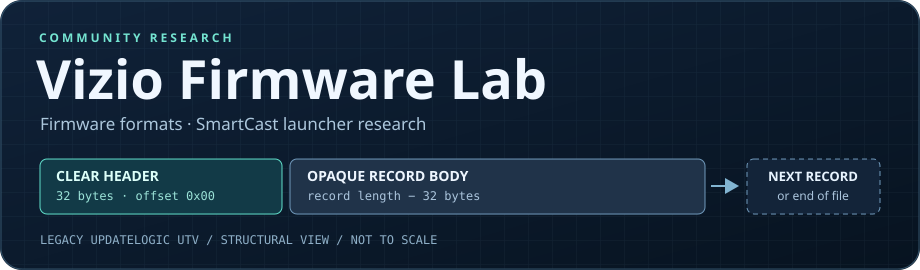

<div align="center">



# Vizio Firmware Lab

**Community research on Vizio firmware formats and the SmartCast launcher.**

[Quick start](#quick-start) · [Format notes](docs/legacy-utv.md) · [SmartCast Home](docs/smartcast-home.md) · [Contributing](CONTRIBUTING.md)

</div>

This project builds reproducible tools for inspecting firmware files across Vizio models and studies how SmartCast reads its app catalog, places Home tiles, and launches apps. It is independent of Vizio.

## Quick start

Python 3.9 or later. Standard library only. Extract the vendor ZIP locally, then point the tool at its legacy UpdateLogic UTV member.

```bash
python utv.py /path/to/update.utv --verify-roundtrip
```

The tool reports record boundaries, format identifiers, and SHA-256. The optional round-trip check packs the decoded headers again and hashes them alongside the unchanged record bodies. It writes JSON to stdout and requires only read access to the image.

## Research status

| Area | Status |
| --- | --- |
| Legacy UpdateLogic UTV | Clear headers and record boundaries parsed. Header serialization verified against an official sample. |
| Payload extraction | Key headers and component contents require a compatible decoder and matching material. |
| Qterics UTV | Separate format. See the format notes for upstream references. |
| SmartCast Home | App catalog, saved tile placement, and launching are separate questions. Custom tile placement remains open. |

## Help wanted

Independent sample results, differences between model groups, public references to firmware updater implementations, and documented Home launcher findings are welcome. Start with the contribution guidelines.

[Contributing](CONTRIBUTING.md)
